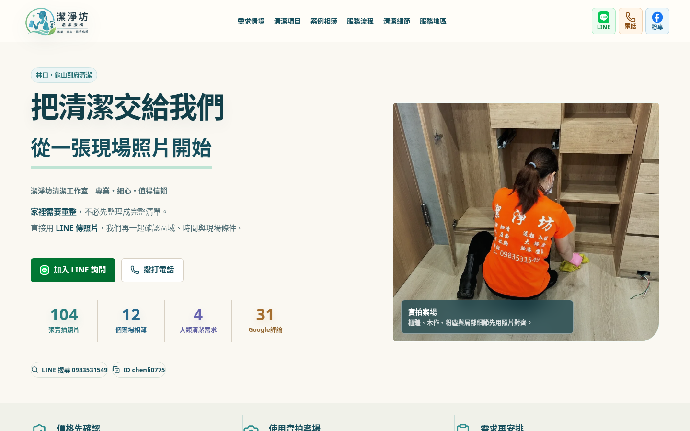
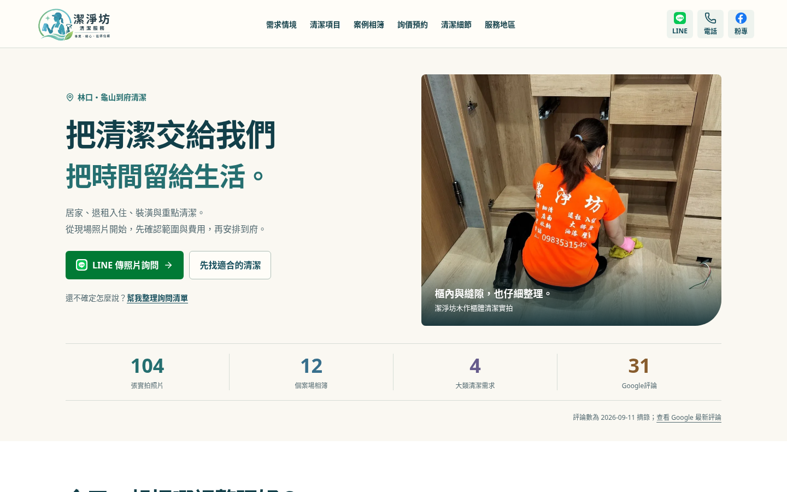
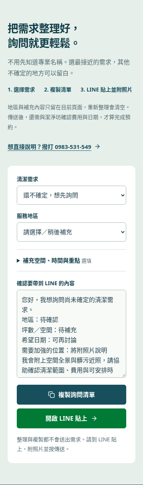

# 潔淨坊：閱讀與詢問節奏覆審

2026-10-18（Asia/Taipei）。本文件是本輪證據附件；唯一維護交接仍是 AI-README.md。

## 基準與判斷

基準 `0e3fb20`，UI/UX 來源為 AI-skill 最新 `c91e2509f1888a11cf6c0073a5d9c333c5ed47a3`。已完整讀取站內交接、實際程式及 UI/UX／Impeccable 整合指引，再以現有 production build 檢查。環境沒有 Impeccable runtime，以下屬人工設計審視與可重現瀏覽器證據，沒有正式 detector 分數或 Lighthouse 分數。

訪客需要選需求、看案例、提出詢問；網站真正轉換仍是 LINE／電話諮詢。原版的主要問題是手機段落太長、清單位於尾端且折疊、服務名稱是無動作標籤、清單不能先補空間與時間，以及案例頁看完照片後缺接續整理需求的入口。

新版統一暖白、深青、實拍與較短段落；需求情境／服務名稱直接帶入清單；清單放到服務後、先選必要資訊再展開選填；首頁及案例共用手機聯絡入口。詢問不會自動送出，更不會自動成立預約。

## 閱讀位置

同一 Chromium、900px 高 viewport、reduced motion、外部地圖封鎖，以 DOM CSS pixel 量測。下列不是成交率或速度指標。

| 寬度 | 首頁總高度（前 → 後） | 清單起點（前 → 後） | 起點提前 |
|---|---|---|---|
| 375px | 14,570 → 11,358 | 12,819 → 4,522 | 64.7% |
| 768px | 13,129 → 8,352 | 11,621 → 3,135 | 73.0% |
| 1440px | 8,258 → 7,536 | 6,910 → 2,428 | 64.9% |

[更新前數據](2026-10-18/before-layout.json) · [更新後數據](2026-10-18/after-layout.json)

原清單為折疊內容，新清單直接可用且含更多選填功能。首屏與固定 dock 均可跳到清單，訪客無需一路捲到底。

## 首屏圖片

相同本機瀏覽器、全新 context、375／768／1440 × 900、無捲動、networkidle；以 Resource Timing 的圖片 encodedBodySize 計算，外部請求封鎖。原版從同一基準重新 build，使用相同依賴；不是正式網路速度／LCP。

| 寬度 | 原版圖片 bytes | 新版圖片 bytes |
|---|---:|---:|
| 375px | 171,122 | 171,122 |
| 768px | 439,844 | 209,328 |
| 1440px | 2,056,808 | 794,021 |

沒有增加圖片素材或改寫原始照片。實際首屏預載範圍取決於瀏覽器的 lazy-load 距離；這組結果不代表所有裝置都相同比例。[資源逐項與邊界檢查](2026-10-18/layout-performance.json)

## 驗證

- 最終 lint／build／公開產物檢查通過：104 原圖、12 相簿與縮圖、2 原片及 Web 版 hash、faststart、prerender、CNAME、noindex 與既有 JSON-LD。
- 最終 Chromium／Firefox × 375／768／1440：篩選、舊錨點、圖片解碼、兩片播放與尾端跳轉、詢問清單、無 JS 備援、FAQ／提示連結通過。[結果](2026-10-18/local-browser-results.json)
- 新增測試覆蓋：未知 service 不誤選、服務選擇保留已填草稿、案例帶入、複製成功／拒絕備援、複製等待時編輯需重複製、刷新清空補充內容、不把草稿放進網址／事件／儲存區、dock 電話事件只記一次。
- 320／390／600／819／820／1079／1080／1440 首頁及案例無水平溢出、錨點有效；手機選單 44px 與 Escape 正常。375／768／1440 實際畫面已目視。
- 獨立 reviewer 另外以 Chromium 實測 320–1440 七寬度、草稿／隱私、clipboard、無 JS 與鍵盤、跨案例入口並目視三斷點，無有證據的 P1／P2。部署核對腳本另外覆審無誤判成功問題。
- macOS WebKit 由既有 PR／main CI 執行，成功前不得稱三引擎已驗。PR／合併 SHA 見 [PR #5](https://github.com/Campcool/0983531549/pull/5)；發布實際結果見該合併提交的 [GitHub Actions](https://github.com/Campcool/0983531549/actions/workflows/deploy.yml) 與 AI-README 的 J2 說明。

外部 LINE／電話／地圖請求在本機測試封鎖，不會發送假詢問。未驗實體 iOS／Android／LINE webview 或客服收件，GA4 ID 空白，不宣稱營收、成交率、搜尋排名或正式 LCP 改善。

## 畫面

### 手機首頁

更新前：

更新後：

### 桌面首頁

更新前：

更新後：

### 詢問清單與案例入口

768px 前後首屏同目錄保存。截圖的地圖使用本機替代／封鎖，不代表地圖連線已驗。

## 正式發布核對範圍

部署 job 下載同 run Pages artifact，核對正式首頁／案例／管理頁、首頁與案例直接引用 CSS／JS、代表實拍的 HTTP 200 與 SHA-256；失敗會令工作失敗。這不是所有媒體或動態匯入模組逐檔下載驗證。完整原始媒體仍由 build 階段的產物門禁驗證。
